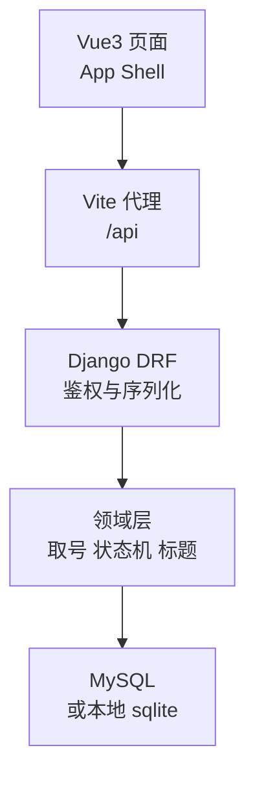

# 多人协作管理平台

> 第一期全栈实现：需求单管理页（**平台的一个页面，不是平台本身**）· Vue 3 + Django + MySQL · 2026-11-27
> 需求与架构依据：`多人协作管理平台_需求架构设计_需求单管理页.md`（v1.3）
> 视觉依据：`前端视觉设计调研与设计准则.md`（v2.0）

## 方向声明

**工程控制台（Engineering Console）**：这是给多人协作团队用的开发者工作台，不是作品集。近黑三层底、1px 结构线、等宽字承载单号与编号、单一低饱和青绿只标记「当前所在」与主动作；全无衬线 / 等宽字体，**不用中文艺术字、纸感 ins 风、渐变光晕**。科技感来自信息密度与秩序，不来自霓虹特效。

第二次评审后确定的三条硬约束：

1. **平台级命名**：侧栏品牌 / 登录页 / 浏览器标题是「协作平台」；当前页 H1 是「需求单」；面包屑 `协作平台 / 项目管理 / 需求单`。导航按平台能力域分组（项目管理 / 代码工程 / 交付部署 / 洞察），Git 仓库、分支查看、流水线、部署记录等 9 项已占位。
2. **状态即路径**：列表每行是 4 段迷你进度条，详情是带节点、连线与每步时间的横向流程图；已挂起 / 已取消走旁路标注，不硬塞进主线。
3. **一屏一个焦点**：需求表格与进度是主角，顶部只给上下文，不做 KPI 卡片或统计大屏。

联网调研结论、设计令牌与反模式清单在 `前端视觉设计调研与设计准则.md`；平台定位与导航扩展位在 v1.3 设计文档。

## 本次交付

| 层 | 内容 |
| --- | --- |
| 后端 | Django + DRF：团队域、需求单域、发号、无评审状态机、乐观锁、commit 标题模板、成员反查鉴权、统一错误码 |
| 前端 | Vue 3 + Vite + Pinia + Vue Router：平台级导航栏（4 能力域 10 项）、团队切换器与团队管理抽屉、需求单页、筛选/列表/新建/详情/编辑/状态轮转/一键复制，手写 CSS 零组件库 |
| 可视化 | `StoryProgress.vue`：列表 4 段迷你进度条 + 详情横向流程图（节点/连线/每步真实时间/旁路标注） |
| 数据 | 5 张自建表 + Django 内置用户表；MySQL 8.0 为正式库，sqlite 为本地烟测分支 |
| 辅助 | `seed_demo.py` 演示数据、`smoke_test.py` 端到端验收脚本、`.env.example` 变量清单 |



## 技术栈与版本

| 项 | 版本 / 说明 |
| --- | --- |
| Python | 3.10（本机验证环境） |
| Django | `>=3.2.25,<5.0`，本机 3.2.25 |
| DRF | `>=3.12,<3.16` |
| 数据库驱动 | `PyMySQL>=1.1,<2.0`（纯 Python，Windows 无需编译 mysqlclient） |
| Node | 22（本机验证环境） |
| Vue / Router / Pinia | `^3.4.21` / `^4.3.0` / `^2.1.7` |
| Vite | `^5.2.8` |

前端**不依赖任何 UI 组件库**，也没有 axios（用原生 `fetch` 封装），依赖只有 vue / vue-router / pinia / vite。

## 目录

```
backend/
  manage.py  requirements.txt  .env.example
  seed_demo.py            本地演示数据
  smoke_test.py           端到端验收（10 组检查）
  config/                 settings / urls / wsgi / asgi
  apps/common/            权限类、异常、查询隔离、分页
  apps/accounts/          登录 / 当前用户 / 退出 / 用户搜索
  apps/teams/             Team / TeamMember / TeamCounter + 成员管理
  apps/stories/           Story / StoryTransition + 发号、状态机、commit 标题
frontend/
  package.json  vite.config.js  index.html  .env.example
  src/config/menuConfig.js      平台导航唯一数据源（4 能力域 / 10 项）
  src/config/constants.js       展示用中文标签 + 状态主线步骤
  src/styles/                   tokens.css / base.css / components.css（深色设计系统）
  src/router / stores / api / utils
  src/layouts/AppShell.vue
  src/components/               SideNav / TopBar / TeamSwitcher / TeamManageDrawer / ToastHost
  src/views/Login.vue
  src/views/story/               StoryManage + components/
                                 （含 StoryProgress.vue 状态流程图）
```

## 快速启动

以下命令用 Git Bash（Windows）执行；PowerShell 把 `export VAR=x` 换成 `$env:VAR="x"`。

### A. 本地烟测：不需要 MySQL 服务

```bash
# 终端 1：后端
cd backend
python -m venv .venv
source .venv/Scripts/activate
pip install -r requirements.txt
export DB_ENGINE=sqlite
python manage.py migrate
python seed_demo.py
python smoke_test.py
python manage.py runserver 127.0.0.1:8000

# 终端 2：前端（另开一个）
cd frontend
npm install
npm run dev
```

浏览器打开 `http://127.0.0.1:5173`，用演示账号登录。Vite 把 `/api` 代理到 `8000`，所以不需要 CORS 配置。

### B. 接 MySQL 8.0（正式库）

```bash
mysql -u root -p -e "CREATE DATABASE collab DEFAULT CHARACTER SET utf8mb4 COLLATE utf8mb4_unicode_ci;"

cd backend
export DB_ENGINE=mysql
export DB_NAME=collab DB_USER=root DB_PASSWORD='<你的口令>' DB_HOST=127.0.0.1 DB_PORT=3306
export DJANGO_SECRET_KEY='<随机字符串>'
python manage.py migrate
python manage.py runserver 127.0.0.1:8000
```

口令只通过环境变量注入，不要写进任何提交文件；仓库里只有 `.env.example` 变量清单。

### C. 演示账号

| 账号 | 角色 | 口令 |
| --- | --- | --- |
| `zhangsan` | 星河项目组 owner | `demo12345` |
| `lisi` | 成员 | `demo12345` |
| `wangwu` | **不属于该团队**（用于验证 403） | `demo12345` |

口令可用 `DEMO_PASSWORD` 环境变量覆盖。**`seed_demo.py` 仅用于本地演示，生产环境不要执行，也不要沿用这些账号与口令。**

演示库预置 8 条历史需求（`STAR-1016` ~ `STAR-1023`），计数器停在 1023，所以登录后新建的第一条正好是 `STAR-1024`，与设计文档的贯穿例子一致。

## 环境变量清单

| 变量 | 默认值 | 用途 |
| --- | --- | --- |
| `DB_ENGINE` | `mysql` | `mysql` / `sqlite` |
| `DB_NAME` / `DB_USER` / `DB_PASSWORD` / `DB_HOST` / `DB_PORT` | `collab` / `root` / 空 / `127.0.0.1` / `3306` | MySQL 连接 |
| `DJANGO_SECRET_KEY` | 开发占位值 | 生产必须注入 |
| `DJANGO_DEBUG` | `true` | 生产设为 `false` |
| `DEMO_PASSWORD` | `demo12345` | 仅 `seed_demo.py` 与 `smoke_test.py` 使用 |

程序只读进程环境变量，不会自动加载 `.env` 文件；`.env.example` 只是清单。

## 接口摘要

| 方法 | 路径 | 用途 |
| --- | --- | --- |
| `POST` | `/api/v1/auth/login/` | 登录，返回 `Token` |
| `GET` / `POST` | `/api/v1/teams/` | 我的团队 / 建团 |
| `GET` / `POST` / `DELETE` | `/api/v1/teams/{id}/members/...` | 成员管理 |
| `GET` / `POST` | `/api/v1/teams/{id}/stories/` | 需求单列表（分页/筛选）/ 新建 |
| `GET` / `PATCH` | `/api/v1/teams/{id}/stories/{sid}/` | 详情（含 `commit_title` 与流转记录）/ 编辑 |
| `GET` / `POST` | `.../{sid}/transitions/` | 流转历史 / 状态轮转 |

认证头：`Authorization: Token <token>`。URL 里的 `team_id` 只是查询线索，服务端一律用登录态反查 `team_member`，查不到返回 `403 NOT_TEAM_MEMBER`。

**commit 标题格式已定稿**：`{type}: {title} --story={no_seq}`，例如 `feat: 支持导出月报 --story=1024`。模板只在后端 `apps/stories/commit_title.py` 一处，接口返回 `commit_title` 成品，前端只负责复制到剪贴板——不写库、不连 Git、不记录 SHA。

## 与设计文档的实现级偏离

| 项 | 设计文档 | 实现 | 理由 |
| --- | --- | --- | --- |
| UI 组件库 | 建议 Element Plus / TDesign | 手写 CSS，零组件库 | 组件库默认外观正是「平均化审美」的主要来源；目录与组件命名仍按文档保留 |
| 认证 | 建议 simplejwt | DRF 内置 `TokenAuthentication` | 本机未装 simplejwt，内置 Token 零额外依赖；接口形态不变，后续可平替 |
| 数据库 | MySQL 8.0 | MySQL + `DB_ENGINE=sqlite` 本地分支 | 本机无 MySQL 客户端；sqlite 只用于本地验证 |
| 表格列 | 列表含更新时间 | 去掉该列，时间保留在页头与详情 | 避免重复指标；去掉后八列在常见桌面视口内全部可见 |
| 导航配置 | 菜单项含 `icon`，4 项 | 不设 icon；按 4 个能力域分 10 项，9 项「待开放」 | 平台要能一眼看出还有 Git 仓库、分支、流水线、部署等能力 |
| **视觉方向（v2.0 改）** | 初版「档案台账」纸感 + 宋体艺术字 | **「工程控制台」深色近黑 + 青绿强调 + 等宽/无衬线** | 评审否决艺术字与 ins 风，要求程序员工作科技风 |
| **平台级命名（v1.3 改）** | 初版侧栏品牌写成「需求台账 · 多人协作 · 需求单管理」 | 侧栏/登录页/浏览器标题「协作平台」，H1「需求单」，面包屑 `协作平台 / 项目管理 / 需求单` | 这是平台不是单页面 |
| **状态呈现（v1.3 改）** | 状态文字标签 | 列表 4 段进度条 + 详情横向流程图（节点/连线/每步时间/旁路） | 评审要求：单文字不够一目了然当前进展 |
| 行点击 | 整行打开详情 | 整行可点 + 标题可聚焦按钮 | 键盘可达，`:focus-visible` 有焦点环 |

状态机（规划中 → 开发中 → 待测试 → 已发布，取消评审）、单号规则、需求类型枚举、commit 标题格式、团队隔离、导航栏扩展位与接口契约，**全部按 v1.3 文档实现**。

## 验证记录（本机实跑）

| 检查 | 结果 |
| --- | --- |
| `python manage.py check` | 0 issues |
| `python manage.py makemigrations` + `migrate` | 6 个 app 全部建表成功 |
| `python smoke_test.py` | 10 组全通过：发号、白名单、commit 标题精确值、无评审状态机、409 版本冲突、非法流转、伪造角色、非成员 403、类型枚举、特殊字符清洗、跨团队 404 |
| `npm run build` | 成功，68 modules，JS 150 KB / CSS 25 KB |
| 浏览器实拍（第一轮） | 登录 → 列表 → 详情抽屉 → 新建弹窗 → 实际创建 `STAR-1024` 全流程可用；控制台 0 个 error |
| 浏览器实拍（改版后） | 深色工作台、平台级品牌与四组导航、面包屑、列表进度段、详情主线流程图（已发布）与旁路流程图（已挂起）均正确；控制台 0 个 error |

第一轮实拍修掉了三个真实问题：数字列被省略号截断、侧栏/顶栏 sticky 叠加遮住首行、宽表把「复制」列挤出视口；改版后八列在常见桌面视口内仍完整可见。

## 后续功能怎么加

导航栏预留不是空框。`frontend/src/config/menuConfig.js` 已按平台能力域分好四组、共 10 项（1 项可用 + 9 项 `enabled: false`），界面上显示灰色「待开放」：

| 能力域 | 模块 |
| --- | --- |
| 项目管理 | 需求单（本期）、迭代、缺陷 |
| 代码工程 | Git 仓库、分支查看、代码评审 |
| 交付部署 | 流水线、部署记录、环境配置 |
| 洞察 | 数据报表 |

加一个功能只需三步：

1. 在 `menuConfig.js` 把该项改成 `enabled: true`（或新增一项）；
2. 在 `src/router/index.js` 加一条 `/teams/:teamId/<path>` 路由，指向 `src/views/<域>/` 下的新页面；
3. 后端在 `backend/apps/` 新建 app，复用 `apps/common/permissions.py` 的 `IsTeamMember`，在 `config/urls.py` 加一行 `include`。

团队上下文（`useTeamStore.currentTeamId`）、成员关系与鉴权、以及新业务表的 `team_id` 约定都已就位，不需要改 Shell 或权限模型。

## 本地生成物与仓库

当前目录尚未初始化 git。若之后要纳入版本管理，建议把本地生成物与个人调研文档排除在提交之外（正式设计文档与 README 可正常入库）：

```bash
git init
cat >> .git/info/exclude <<'EOF'
frontend/node_modules/
frontend/dist/
backend/.venv/
backend/db.sqlite3
backend/media/
backend/**/__pycache__/
前端视觉设计调研与设计准则.md
EOF
```
