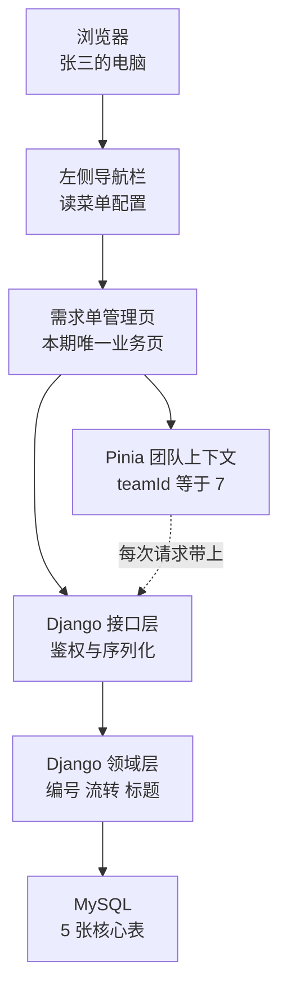
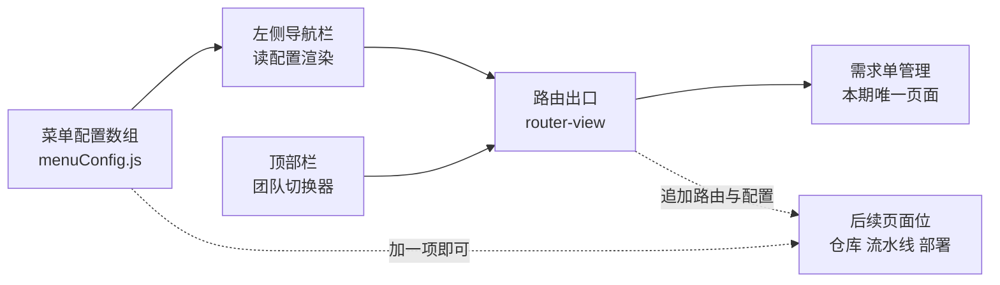
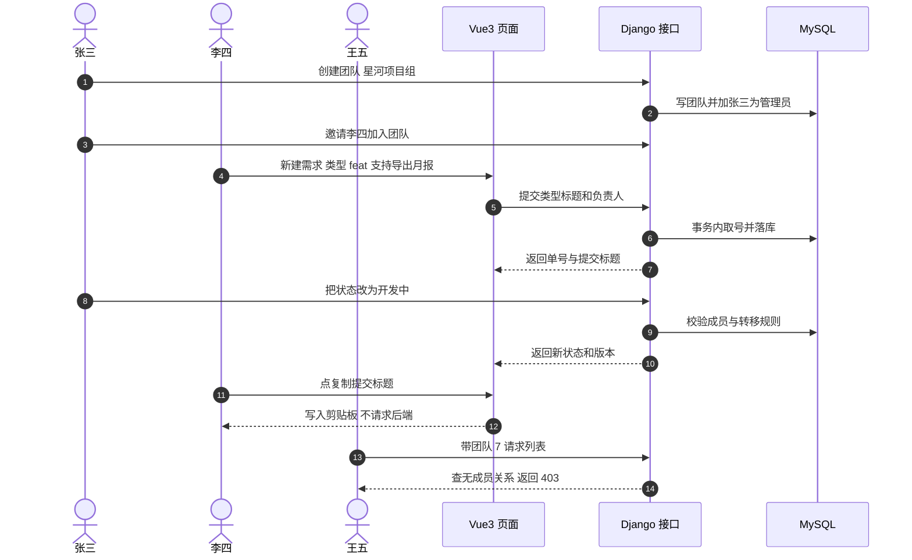
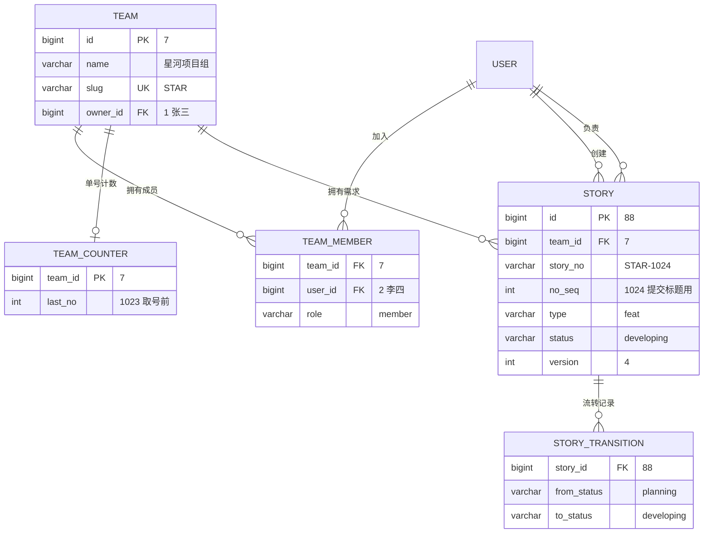
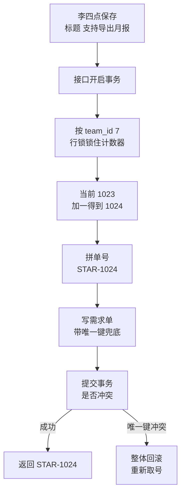
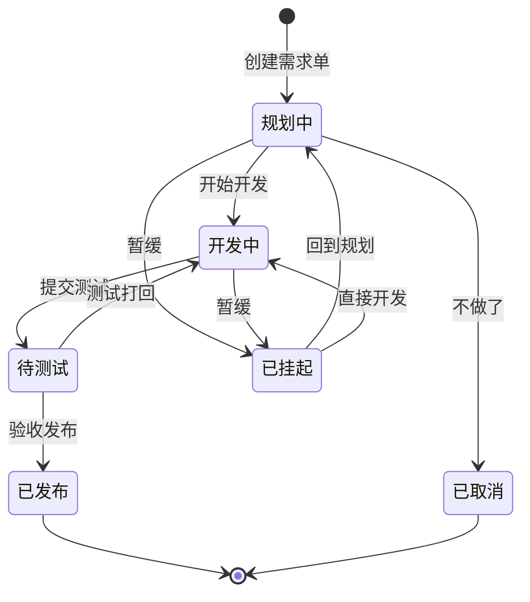
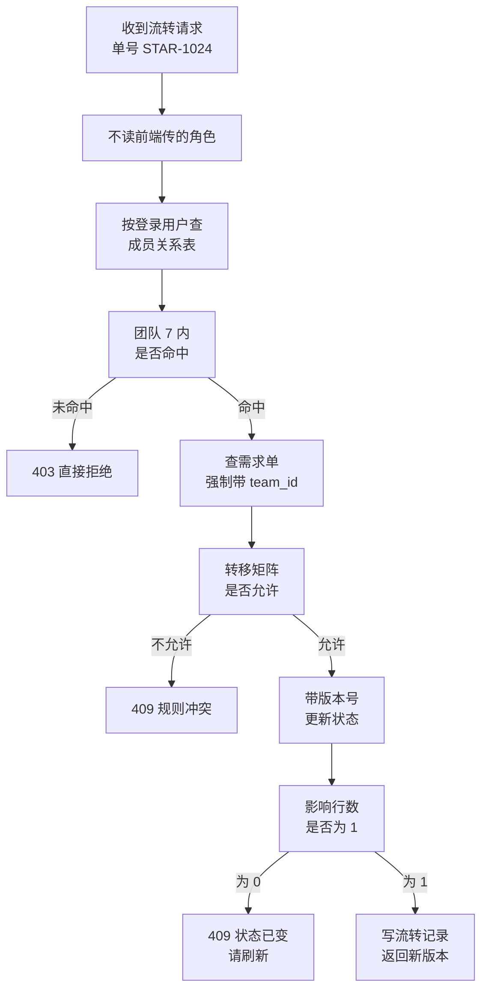
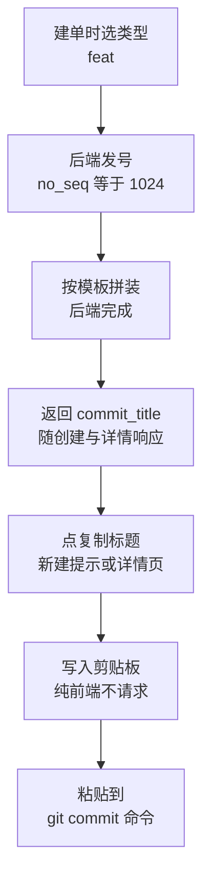
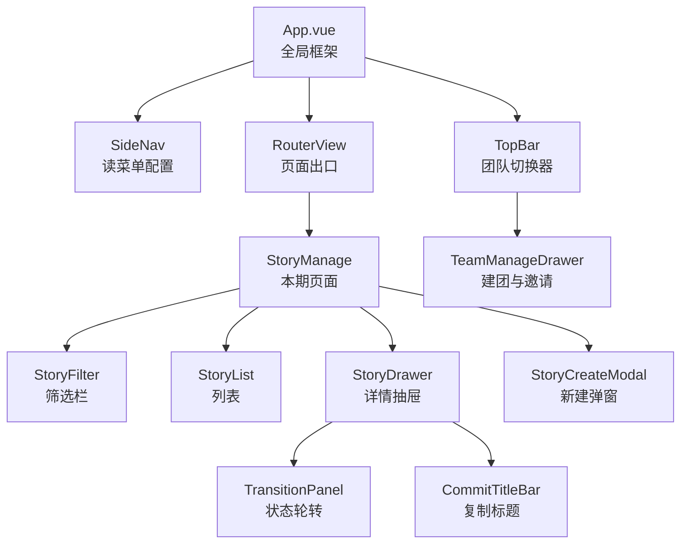

# 多人协作管理平台 · 需求架构设计
## 第一期：需求单管理页（类似 TAPD 的需求单）

> **文档性质**：需求拆解 + 系统架构设计（本期不产出业务代码）
> **技术栈**：Vue 3 + Django + MySQL 8.0
> **版本**：v1.3 / 2026-11-27
> **一句话结论**：本期只交付「需求单管理」一个业务页面，但要把团队、单号、无评审的状态机、需求类型与 commit 标题一键复制、App Shell（含导航栏扩展位）一次设计到位，后续功能靠「加配置 + 加路由 + 加 app」接入，不返工。

**阅读方式**：全文用同一个例子讲到底，别跳着看。例子里的值在第 2.1 节固定下来，后面每一张表、每一段接口、每一条用例都复用它。文末附录 A 是取值速查表。

### 修订记录

| 版本 | 变更 | 依据 |
| --- | --- | --- |
| v1.0 | 初稿：状态机含「待评审」与评审通过/驳回；commit 侧按「绑定真实 SHA + Webhook 自动回写」设计 | — |
| **v1.1** | ① **取消评审环节**：「待评审」改为「规划中」，删掉评审通过/驳回动作，创建后由排期人直接点「开始开发」；② **commit 侧整体换需求**：改为「创建需求单时选类型（feat/fix…）+ 一键复制 commit 标题」，移除 `story_commit` 表、绑定接口与 Webhook 链路 | 第一次评审意见 |
| **v1.2** | **commit 标题格式定稿**：`{type}: {title} --story={no_seq}`，即 `feat: 支持导出月报 --story=1024`；半角冒号、字面保留 `--story=`、尾部用纯数字序号 `no_seq` 而非完整单号；4.3 候选表移除，第 11 章 #1 转为定稿记录 | 确认 |
| **v1.3** | ① **纠正平台级定位**：侧栏品牌、登录页标题、页面标题层级改为「平台名 → 分组 → 当前页」，禁止把平台名写成当前页名；② **导航栏扩展位补齐**：菜单分组扩到项目管理 / 代码工程 / 交付部署 / 洞察，明确 Git 仓库、分支查看、流水线、部署记录等占位；③ **状态改为进度可视化**：列表与详情必须用流程图/进度段呈现当前进展，不能只有状态文字；④ **视觉方向改为开发者工具科技风**，去掉艺术字与纸感编辑风 | 第二次评审意见 |

---

## 0. 先说结论

### 0.1 本期交付边界

| 范围 | 具体内容 | 为什么 |
| --- | --- | --- |
| **本期要做** | 需求单管理页（列表/筛选/详情/新建/编辑/状态轮转）；**创建时选需求类型**；**一键复制 commit 标题**；支撑它的团队组建与成员管理；登录态；左侧导航栏 + 顶部团队切换器 | 用户点开就能把「建团队 → 建需求选类型 → 拿单号 → 改状态 → 复制提交标题」跑通 |
| **本期不做，但必须留出位置** | 迭代、缺陷、看板统计、报表、通知；**Git 仓库与分支查看、代码评审、流水线、部署记录、环境配置**；真实 Git 提交回写与校验、评论/附件、父子需求 | 你明确说了「这是多人协作管理平台，需求单只是其中一个页面」，所以导航结构与能力域占位要按平台来长，代码上先不写 |
| **本期明确不做** | 平台首页/Dashboard、总览大屏、跨团队全局搜索、需求单导入导出；**不自动创建 git commit、不记录 commit SHA、不校验开发同学是否真的用了这个标题** | 属于「总页面」或 v1.0 的旧理解，会稀释本期目标 |

### 0.2 三条最要紧的设计决策

| # | 决策 | 换成白话 |
| --- | --- | --- |
| 1 | **App Shell 与业务页分离**：左侧导航栏、顶部团队切换器属于全局框架，需求单管理页只是 `router-view` 里的一个 view | 导航栏不是画在页面里的一个框，而是独立一层；以后加页面不动这层 |
| 2 | **团队是所有数据的根**：未来每一张业务表都带 `team_id`；当前团队 ID 放 Pinia 全局 store，不是页面局部变量 | 以后做「缺陷」「迭代」，天然挂在同一个团队下，不用改权限模型 |
| 3 | **安全判定只认服务端查出来的东西**：前端传的团队 ID、角色、单号、目标状态，一律不作为权限或数据依据 | 前端能把 `role` 改成 `admin`、把 `team_id` 改成 7，后端必须从成员表反查；查不到就拒绝，不静默放行 |

> 第 3 条不是顺带一提的口号。第 8 章专门写了威胁模型，第 7.3 节给出对应的服务端代码骨架。

### 0.3 本次修订带来的结构简化

改完这两点，系统比 v1.0 更轻，不是换个名字了事：

| 变化 | v1.0 | v1.1 |
| --- | --- | --- |
| 状态机 | 待评审 →（评审通过/驳回）→ 开发中 | **规划中 →（开始开发）→ 开发中**，没有审批人、没有通过/驳回，谁排好期谁点 |
| 自建表数量 | 6 张（含 `story_commit`） | **5 张**，commit 标题不落库，由「类型 + 标题 + 纯数字序号」实时拼出 |
| 写接口 | 有 `POST/DELETE commits` 两个 | **0 个**；一键复制是纯前端剪贴板行为，不调后端、不写库、无并发问题 |
| 前后端模板 | — | **模板只在后端一份**，接口直接返回 `commit_title`，前端只负责复制，不会两边拼出不一样的结果 |

---

## 1. 起因：这个页面到底要解决什么

### 1.1 场景白话版

几个人要一起做一个项目，最原始的做法是拉个群 + 一个共享表格。表格撑不住三件事：谁负责说不清、状态改了没记录、代码提交和需求对不上。

本期页面就是把这张表格换成系统里的一条条需求单，并且：

- 先有**团队**：张三建一个「星河项目组」，把李四加进来，只有这两人能看见组内的东西；
- 再有**需求单**：李四提一条《支持导出月报》，**建单时选类型是 `feat`**，系统自动给它一个号 `STAR-1024`；
- 需求单有**状态**：规划中 → 开发中 → 待测试 → 已发布，谁能点、能点成什么，是定死的规则，不是随便改个下拉框。**没有评审这一步**，排好期直接开工；
- 每次改状态**留痕**：谁、什么时候、从哪个状态改到哪个状态、写了什么备注；
- **一键复制 commit 标题**：李四写完代码要提交时，在需求单上点一下，剪贴板里就是 `feat: 支持导出月报 --story=1024`，直接粘到 `git commit` 命令里。这样提交信息天然带需求序号（`--story=1024`），以后看 commit 就知道对应哪条需求，而系统不需要去连 Git 仓库。

### 1.2 「只是一个页面」怎么理解

你特别强调「这只是一个页面，不是总页面，需要预留导航栏供后续其他功能使用」。这里有个容易被忽略的矛盾：**团队组建、成员邀请这些功能，如果各开一个页面，就不止一个页面了。**

本期的处理办法：

- 团队创建、成员添加/移除，全部放进**顶部团队切换器拉开的抽屉（Drawer）**里，属于 App Shell 的局部交互，不新增路由、不新增页面；
- 需求单的新建用弹窗（Modal），详情用右侧抽屉，同样不新增路由；
- 因此全站**只有一个业务路由** `/teams/:teamId/stories`，但功能完整。

**平台级命名约定（本次评审新增，硬约束）**：这是「多人协作管理平台」，需求单只是它的一个页面。App Shell 属于平台，不属于需求单：

| 位置 | 必须显示 | 禁止显示 |
| --- | --- | --- |
| 侧栏品牌区、登录页主标题、浏览器标题 | 平台名「协作平台」+ 版本/工作区标识 | 「需求台账」「多人协作 · 需求单管理」这类把当前页当平台的写法 |
| 页面 H1 | **当前功能名**「需求单」 | 把 H1 写成平台名，或把品牌文字塞进页面标题 |
| 页面面包屑 | `协作平台 / 项目管理 / 需求单` | 缺失层级，让人误以为整个平台只有需求单 |
| 左侧导航 | 按平台能力分组，需求单只是「项目管理」组里的一项 | 只列需求单相关项 |

后续会接入 Git 仓库分支查看、流水线、部署记录等模块，所以导航结构必须一眼看出「平台 > 多个能力域 > 当前页」，而不是围绕需求单组织。

下面这张图是本期系统分层，注意「需求单管理页」只是其中一格。



### 1.3 页面骨架与导航栏扩展位

导航栏的「预留」不是留一块空白，而是**配置驱动**：菜单长什么样由 `menuConfig.js` 一个数组决定，本期只有一项可用，其余项先写成占位配置。以后加功能，改数组 + 加路由 + 加 view 文件即可，导航栏组件本身不改。



关键设计点，逐条说明：

| 点 | 做法 | 以后加功能时的动作 |
| --- | --- | --- |
| 菜单配置 | `menuConfig.js` 导出数组，每项含 `key / title / path / group / enabled`；`group` 按平台能力域分组 | 数组里加一项，`enabled` 置 `true` |
| 占位项 | `enabled: false` 的项渲染成灰色 + 「待开放」，不可点击 | 把 `enabled` 改成 `true` |
| 路由表 | `router/index.js` 集中注册，`/teams/:teamId/...` 作为业务路由统一前缀 | 加一条 route 指向新 view |
| 团队上下文 | `useTeamStore().currentTeamId` 全局持有，切换团队时清空各业务 store 缓存 | 新页面直接读同一个 store |
| 后端前缀 | `/api/v1/teams/{team_id}/<域>/...`，每个 Django app 独立 `urls.py` | 加一个 app，主 `urls.py` 加一行 `include` |
| 权限复用 | `IsTeamMember` 做成 DRF 权限类放在 `apps/common/` | 新 app 的 ViewSet 直接挂这个类 |

**菜单配置长这样**（这是本期唯一需要写死的配置文件，逐行解释）：

```js
// src/config/menuConfig.js
export default [
  { key: 'story',      title: '需求单',   path: 'stories',      group: '项目管理', enabled: true },
  { key: 'iteration',  title: '迭代',     path: 'iterations',   group: '项目管理', enabled: false },
  { key: 'bug',        title: '缺陷',     path: 'bugs',         group: '项目管理', enabled: false },
  { key: 'repo',       title: 'Git 仓库', path: 'repos',        group: '代码工程', enabled: false },
  { key: 'branch',     title: '分支查看', path: 'branches',     group: '代码工程', enabled: false },
  { key: 'review',     title: '代码评审', path: 'reviews',      group: '代码工程', enabled: false },
  { key: 'pipeline',   title: '流水线',   path: 'pipelines',    group: '交付部署', enabled: false },
  { key: 'deploy',     title: '部署记录', path: 'deployments',  group: '交付部署', enabled: false },
  { key: 'env',        title: '环境配置', path: 'environments', group: '交付部署', enabled: false },
  { key: 'report',     title: '数据报表', path: 'reports',      group: '洞察',     enabled: false },
]
```

- 第 2 行：本期唯一可用项，`path: 'stories'` 会拼成 `/teams/{teamId}/stories`；
- 第 3~11 行：占位项，`enabled: false`，导航栏仍然渲染（灰色不可点）。分组按**平台能力域**而不是按当前页组织：项目管理 / 代码工程 / 交付部署 / 洞察；
- 「Git 仓库 / 分支查看 / 流水线 / 部署记录」是你明确提到的后续功能，现在就以占位项存在，以后接好后端只需改 `enabled` + 加路由 + 加 view；
- `group` 决定分组标题，新增能力域只加一个新 `group` 值，`SideNav.vue` 自动归组，不用改组件；
- 顶部团队切换器不属于菜单配置，它是常驻组件，因为后续每个页面都要用。

---

## 2. 经过：跟着 `STAR-1024` 走一遍完整时间线

这一章不谈架构，只把一件事从头到尾演一遍。后面所有设计都是为了让这条时间线跑得通、拦得住。

### 2.1 出场角色与固定取值

| 东西 | 具体值 | 说明 |
| --- | --- | --- |
| 团队 | `星河项目组`，`id=7`，`slug=STAR` | 单号前缀就是 `STAR` |
| 张三 | `user_id=1`，角色 `owner` | 建团的人，自动成为管理员 |
| 李四 | `user_id=2`，角色 `member` | 被拉进团队，负责开发 |
| 王五 | `user_id=3`，**不属于该团队** | 用来验证越权拦截 |
| 需求单 | `id=88`，`STAR-1024`，《支持导出月报》，**类型 `feat`** | 创建人李四、负责人李四、优先级 `high` |
| commit 标题 | `feat: 支持导出月报 --story=1024` | 一键复制得到的那串文本，不落库 |
| 一次流转 | 规划中 → 开发中，`version` 3 → 4 | 乐观锁就靠这个数字 |

### 2.2 时间线六步

1. **张三建团**：填团队名「星河项目组」、前缀 `STAR`。后端建一条 `team(id=7)`，同时往 `team_member` 写一条 `(team_id=7, user_id=1, role=owner)`，并在 `team_counter` 初始化一行 `last_no=0`。这三件事在一个事务里，要么都成，要么都不成。
2. **张三加李四**：在团队抽屉里搜到李四，点添加。`team_member` 多一行 `(7, 2, member)`。此时王五在库里没有任何一行和 `team_id=7` 相关。
3. **李四建需求单**：**类型选 `feat`**，填标题《支持导出月报》、负责人选自己、优先级 `high`，点保存。**请求里没有单号、没有状态、没有团队角色这类字段**。后端在事务里把 `last_no` 从 1023 加到 1024，拼出 `STAR-1024`，以 `planning`（规划中）落库，`version=1`，并按模板拼好 `feat: 支持导出月报 --story=1024` 一并返回。页面立刻显示单号，toast 上带「复制 commit 标题」按钮。
4. **张三排期后开工**：排期定下来，张三在详情抽屉的「状态」区点「开始开发」——**没有评审、没有审批人、没有通过或驳回**。请求只带 `action=start`、`version=3`、备注「排期确定，安排李四开发」。后端先查张三是不是 7 号团队成员（是，owner），再查转移矩阵（`start` 把规划中变成开发中），再带 `version=3` 更新，成功后 `version=4`，同时往 `story_transition` 追加一条记录。
5. **李四一键复制提交标题**：开发完要提交代码，在详情抽屉顶部点「复制 commit 标题」，剪贴板里得到 `feat: 支持导出月报 --story=1024`，粘贴到 `git commit` 命令即可。**这一步是纯前端行为：不调接口、不写表、不需要后端知道他有没有真的提交。**
6. **王五来试一下**：王五手动拼一个请求，`team_id=7` 拉需求单列表。后端拿登录态里的 `user_id=3` 去 `team_member` 查 `(7, 3)`，查不到，直接 403 `NOT_TEAM_MEMBER`。哪怕他把请求体里塞上 `role=admin` 也没用——后端根本不读这个字段。

> 例子里 `version=3` 而不是 1，是为了说明：前面还有过两次编辑（改描述、把类型从 `docs` 调成 `feat`），每次编辑都会让版本号加一。第 4 步如果另一个人抢先改过，张三手里的 3 就过期了，会被挡下来。

### 2.3 整体时序



### 2.4 结果：这个例子牵动了什么

一条看似简单的「改状态」，实际会碰到下面这些地方。这张表就是本文档后面各章的索引。

| 时间线动作 | 落到哪张表 | 走哪个接口 | 属于哪个机制 | 文档位置 |
| --- | --- | --- | --- | --- |
| 建团、加人 | `team`、`team_member`、`team_counter` | `POST /teams/`、`POST /teams/7/members/` | 团队是根 | 3、5.2 |
| 建需求、选类型、拿号 | `team_counter`、`story` | `POST /teams/7/stories/` | 单号生成 + 类型枚举 | 4.1、4.3 |
| 开始开发 | `story`、`story_transition` | `POST /.../88/transitions/` | 无评审状态机 + 乐观锁 | 4.2 |
| 复制 commit 标题 | **不写表** | **无写接口**，标题随创建/详情响应返回 | 模板拼装，纯前端复制 | 4.3、5.3 |
| 王五被拦 | `team_member`（反查） | 任一接口 | 服务端权威鉴权 | 7.3、8 |
| 以后加「缺陷」页 | 新表带 `team_id` | `/api/v1/teams/7/bugs/` | 导航栏扩展位 | 1.3、9 |

---

## 3. 领域模型：团队是根，需求单挂在团队下

### 3.1 表之间的关系



`USER` 不自己建表，直接复用 Django 内置的 `auth_user`（登录、密码哈希、会话都现成）。例子里的 `user_id=1/2/3` 就是这张表的主键。

注意图里**没有 `story_commit`**：commit 标题是从 `story` 的 `type + title + no_seq` 三个字段实时拼出来的字符串，不需要单独存一张表。其中 `no_seq` 是纯数字序号，页面展示用的完整单号 `story_no` 不进 commit 标题。

### 3.2 表清单

| 表名 | 用途 | 例子中的一行 |
| --- | --- | --- |
| `team` | 团队 | `(7, 星河项目组, STAR, owner=1)` |
| `team_member` | 谁在哪个团队、什么角色 | `(7, 2, member)` |
| `team_counter` | 每个团队发号发到几了 | `(7, last_no=1024)` |
| `story` | 需求单本体 | `(88, 7, STAR-1024, feat, 支持导出月报, developing, version=4)` |
| `story_transition` | 状态流转流水，**只追加不修改** | `(88, planning, developing, 操作人1)` |

### 3.3 字段设计

**`team`**

| 字段 | 类型 | 约束 | 说明 |
| --- | --- | --- | --- |
| `id` | BIGINT | PK | 例子里是 7 |
| `name` | VARCHAR(64) | NOT NULL | 团队名，可改 |
| `slug` | VARCHAR(16) | NOT NULL, UNIQUE | 单号前缀，大写字母数字；**创建后不可改**，否则历史单号对不上 |
| `owner_id` | BIGINT | FK → user.id | 创建者，冗余存一份便于展示 |
| `created_at` / `updated_at` | DATETIME | 自动 | — |

**`team_member`**

| 字段 | 类型 | 约束 | 说明 |
| --- | --- | --- | --- |
| `id` | BIGINT | PK | — |
| `team_id` | BIGINT | FK, 联合唯一 | — |
| `user_id` | BIGINT | FK, 联合唯一 | — |
| `role` | VARCHAR(16) | NOT NULL | `owner` / `admin` / `member` |
| `joined_at` | DATETIME | 自动 | — |
| — | — | `UNIQUE(team_id, user_id)` | 同一个人不能加两次 |
| — | — | `KEY(user_id)` | 反查「我加入了哪些团队」用得上 |

> 这是全系统**唯一**的角色来源。前端传来的任何角色字段都不读。

**`team_counter`**

| 字段 | 类型 | 约束 | 说明 |
| --- | --- | --- | --- |
| `team_id` | BIGINT | PK, FK | 一个团队一行 |
| `last_no` | INT | NOT NULL, DEFAULT 0 | 已经发出去的最大序号 |

**`story`**

| 字段 | 类型 | 约束 | 说明 |
| --- | --- | --- | --- |
| `id` | BIGINT | PK | 88 |
| `team_id` | BIGINT | FK, NOT NULL | 团队隔离的锚点 |
| `story_no` | VARCHAR(32) | NOT NULL | `STAR-1024`，页面展示与列表搜索用它；**不进 commit 标题** |
| `no_seq` | INT | NOT NULL | 1024，纯数字；既用于按序号排序，**也是 commit 标题里 `--story=1024` 的取值来源** |
| `type` | VARCHAR(16) | NOT NULL, DEFAULT `feat` | **本期新增**，见下方枚举表；决定 commit 标题前缀 |
| `title` | VARCHAR(200) | NOT NULL | 《支持导出月报》 |
| `description` | TEXT | 可空 | 本期纯文本 / Markdown，不做富文本附件 |
| `status` | VARCHAR(24) | NOT NULL, DEFAULT `planning` | 见 4.2 状态机，创建后默认规划中 |
| `priority` | VARCHAR(16) | NOT NULL, DEFAULT `medium` | `low/medium/high/urgent` |
| `creator_id` | BIGINT | FK | 2（李四） |
| `assignee_id` | BIGINT | FK, 可空 | 2（李四） |
| `version` | INT | NOT NULL, DEFAULT 1 | 乐观锁，每次编辑或流转 +1 |
| `created_at` / `updated_at` | DATETIME | 自动 | — |
| — | — | `UNIQUE(team_id, story_no)` | 编号兜底，见 4.1 |
| — | — | `KEY(team_id, status)` | 列表按状态筛选 |
| — | — | `KEY(team_id, assignee_id)` | 「只看我的」筛选 |

**需求类型枚举（本期 7 种，对齐 Conventional Commits）**

| `type` | 中文 | 什么时候选 | 例子中的输出 |
| --- | --- | --- | --- |
| `feat` | 新功能 | 要做个原来没有的能力 | `feat: 支持导出月报 --story=1024` |
| `fix` | 缺陷修复 | 修一个已有问题 | `fix: 修复月报导出空指针 --story=1025` |
| `docs` | 文档 | 只改文档 | — |
| `refactor` | 重构 | 不改行为的内部结构调整 | — |
| `perf` | 性能 | 优化性能 | — |
| `test` | 测试 | 补测试 | — |
| `chore` | 杂务 | 构建、依赖、配置 | — |

**`story_transition`**（流水表，不更新、不删除）

| 字段 | 类型 | 说明 |
| --- | --- | --- |
| `id` | BIGINT PK | — |
| `story_id` | BIGINT FK | 88 |
| `from_status` / `to_status` | VARCHAR(24) | `planning` → `developing` |
| `operator_id` | BIGINT FK | 1（张三） |
| `remark` | VARCHAR(500) | 「排期确定，安排李四开发」 |
| `created_at` | DATETIME | — |

### 3.4 几条容易踩坑的约束决策

| 决策 | 为什么 |
| --- | --- |
| 所有业务表带 `team_id`，查询必带 `team_id` 条件 | 以后加「缺陷」表时隔离逻辑照抄，不用重新设计权限 |
| `slug` 全局唯一且不可改 | 若允许 `STAR` 改成 `XH`，历史页面单号展示会变；而 commit 标题里只有纯数字 `1024`，前后对不上更难回溯 |
| 流转记录单独成表且只追加 | 「谁把状态改回去过」是协作里最常吵的一件事，靠 `updated_at` 说不清 |
| 不做物理删除 | 需求单删了以后流转历史全成孤儿；本期用「已取消」表达终止 |
| **类型用枚举，不让用户自由输入** | 自由文本会拼出千奇百怪的 commit 标题， Conventional Commits 工具链也认不了；新增类型改一处常量即可 |
| **commit 标题不落库** | 类型、标题、序号任何一个改了，复制出来的内容自动跟着变；存一份快照反而会和实际数据不一致 |
| **`no_seq` 只在团队内唯一** | 不同团队都会有 1024，所以 `--story=1024` 不能单独用于反查；本期不反查，以后要反查需先绑定仓库与团队，见 4.3 与第 9 章 |

---

## 4. 三个核心机制

### 4.1 单号：`STAR-1024` 怎么来的

**规则**：`团队 slug + '-' + 团队内自增序号`，从 1 开始，只增不减、不回收、不跳号（回滚时才可能跳号，见下）。例子里团队已发到 1023，李四这一单就是 1024。

**为什么不交给前端生成**：前端能改请求体，也能并发点两次保存，两个人都算出 1024 就撞了。
**为什么不用 `story.id` 当单号**：自增主键是**全库**共用的，7 号团队的第一条需求可能会是 `id=3917`，单号变成 `STAR-3917`，而且以后导入数据、分库都会乱。

**并发怎么挡**：计数器表按团队一行，`SELECT ... FOR UPDATE` 加行锁，取号、加一、写需求单放在同一个事务；再加 `UNIQUE(team_id, story_no)` 做最后兜底。



对应的 SQL 骨架，逐行解释：

```sql
START TRANSACTION;
SELECT last_no FROM team_counter WHERE team_id = 7 FOR UPDATE;
UPDATE team_counter SET last_no = last_no + 1 WHERE team_id = 7;
INSERT INTO story (team_id, story_no, no_seq, type, title, status, version)
VALUES (7, 'STAR-1024', 1024, 'feat', '支持导出月报', 'planning', 1);
COMMIT;
```

- 第 1 行：把后面四步圈成一个整体，中间任何一步失败全部回滚；
- 第 2 行：`FOR UPDATE` 锁住 7 号团队这一行。另一个人同时建单会在这里排队，不会两人同时读到 1023；
- 第 3 行：先把号占住，再拿去拼单号；
- 第 4~5 行：写需求单，`type` 来自用户选择，但 `status` 和 `version` 由服务端给死，请求体里没有这两个字段的份；
- 第 6 行：提交。万一有人绕过计数器硬塞了同样的号，`UNIQUE(team_id, story_no)` 会在这里报错，捕获后回滚并重试取号，不会出现两条 `STAR-1024`。

> 这次发号同时写出两个字段：`story_no = STAR-1024`（页面展示）和 `no_seq = 1024`（纯数字）。4.3 定稿的 commit 标题取的是后者，即 `--story=1024`；两者同源，不需要第二套编号。

### 4.2 状态轮转：谁把 `STAR-1024` 改成「开发中」

#### 状态机

按评审意见，**「待评审」换成「规划中」，评审这一整步取消**。创建完默认落在规划中，含义是「想做但还没动手」；排好期的人直接点「开始开发」，没有审批人、没有通过或驳回。



「已发布」「已取消」是终态，不能再改回去；要改只能新建一条需求单。这样流转历史才有意义。

状态枚举：`planning` / `developing` / `pending_test` / `released` / `cancelled` / `suspended`。

#### 转移矩阵（这才是「轮转」的规则，不是下拉框随便选）

| 动作 `action` | 从 | 到 | 允许角色 | 附加要求 |
| --- | --- | --- | --- | --- |
| `start` | 规划中 | 开发中 | owner / admin | 必须已填 `assignee_id` |
| `cancel` | 规划中 | 已取消 | owner / admin | 必须填取消原因 |
| `suspend` | 规划中 / 开发中 | 已挂起 | owner / admin | 必须填挂起原因 |
| `submit_test` | 开发中 | 待测试 | owner / admin，或该单负责人本人 | 必须填提测说明 |
| `reopen` | 待测试 | 开发中 | owner / admin，或负责人本人 | 必须填打回原因 |
| `release` | 待测试 | 已发布 | owner / admin | 无 |
| `resume_plan` / `resume_dev` | 已挂起 | 规划中 / 开发中 | owner / admin | 必须填恢复说明 |

> 「成员只能轮转自己负责的需求单」是多人协作的关键：`user_id=2` 的李四不能去改别人负责的单。
> v1.0 里那条「提交测试前至少绑 1 个 commit」的开关**随之取消**——本期不再记录真实提交，没有可校验的对象。

#### 服务端怎么判：先说威胁，再说机制

| 威胁 | 攻击者能改什么 | 改了能多拿到什么 | 服务端怎么挡 |
| --- | --- | --- | --- |
| 非成员发起流转 | 请求里任意 `team_id` / `story_id` | 改别团队的需求状态 | 用登录态 `user_id` 反查 `team_member`，查不到 403 |
| 成员伪造角色 | 请求体塞 `role=admin` | 越权「发布」「取消」 | 角色只从 `team_member` 读，前端同名字段直接忽略 |
| 跳过流程 | 直接传 `status=released` | 绕过开发与测试 | 请求只允许传 `action`，目标状态由矩阵算出，服务端不接受 `status` |
| 改别人的单 | 换一个 `story_id` | 越权操作他人需求 | 查 `story` 时强制带 `team_id`，非本团队视为不存在（404） |
| 并发覆盖 | 两人同时点「开始开发」 | 后一次悄悄覆盖前一次 | 乐观锁 `version` + 影响行数判定，冲突 409 |

判定顺序固定如下，**任何一步失败都默认拒绝，不静默跳过**：



#### 乐观锁 SQL，逐行解释

```sql
UPDATE story
SET status = 'developing', version = version + 1, updated_at = NOW()
WHERE id = 88 AND team_id = 7 AND version = 3 AND status = 'planning';
```

- 第 2 行：状态和版本号**一起**改，改完 `version` 变成 4；
- 第 3 行四个条件各有分工：`id=88` 定位、`team_id=7` 再兜一层隔离、`version=3` 挡并发（别人已经改成 4 就匹配不上）、`status='planning'` 挡重复提交（已经是开发中就匹配不上）；
- 看返回的影响行数：**1 才成功**，随后在同一事务里 `INSERT story_transition`；**0 就返回 409**，告诉前端「状态已被别人改过，请刷新」，绝不静默成功；
- 例子结果：张三这次成功，`STAR-1024` 变成 `developing`、`version=4`，流水表多一行 `(规划中 → 开发中, 操作人张三)`。

### 4.3 commit 标题：一键复制 `feat: 支持导出月报 --story=1024`

这一节按你评审意见重写。v1.0 理解成「绑定真实 Git 提交的 SHA」，不是你要的；你实际要的是：**创建需求单时选类型，选完就能一键复制拼好的 commit 标题**。

#### 模板与格式（已定稿）

按你确认的格式，模板定死为一行常量：

```
{type}: {title} --story={no_seq}
```

| 占位符 | 取值 | 例子 | 来自哪个字段 |
| --- | --- | --- | --- |
| `{type}` | 建单时选的需求类型 | `feat` | `story.type` |
| `{title}` | 需求单标题 | `支持导出月报` | `story.title` |
| `{no_seq}` | **纯数字序号** | `1024` | `story.no_seq` |

拼出来就是：`feat: 支持导出月报 --story=1024`。

三个细节，实施时别写错：

- 冒号是**半角 `:` 加一个空格**，`--story=` 字面保留，等号后面**不带团队前缀**；
- 尾部取的是 `no_seq`（`1024`），**不是**完整单号 `story_no`（`STAR-1024`）。两个字段来自同一次发号，见 4.1 与 3.3；
- 页面上展示、列表里搜索的仍然是完整单号 `STAR-1024`，只有复制出去的 commit 标题用纯数字序号，两者别混。

模板常量放在后端 `commit_title.py`，前端与接口都拿拼好的成品。以后要换格式只改这一行，其余章节不动。

#### 一个要留意的边界：序号只在团队内唯一

`no_seq` 是**团队内**自增的：7 号团队有 `1024`，8 号团队也会有自己的 `1024`。所以 `--story=1024` 这串文本在跨团队时并不唯一，单靠它反查不到具体是哪条需求。

本期**不做反查**，commit 标题只是递给人看的文本，系统不解析它，因此这个重复没有影响。页面上的完整单号 `STAR-1024` 才承担定位职责。

以后若要接 Git Webhook 按标题反查需求，必须先建立「Git 仓库 ↔ 团队」的绑定关系，用 `repo + no_seq` 才能唯一定位；直接拿 `--story=1024` 去全库查会命中多条。这条前提已写进第 9 章扩展位。

#### 从选类型到复制，全流程



**职责划分（关键）**：模板只在后端 `commit_title.py` 一份，创建响应和详情响应都带 `commit_title` 字段；前端拿到字符串直接复制，**不自己拼**。这样不会出现前后端两份模板、拼出两种标题的情况，以后改格式也不用发前端版本。

**一键复制的三个入口**：

| 入口 | 时机 | 交互 |
| --- | --- | --- |
| 新建成功 toast | 刚拿到 `STAR-1024` | 「已创建 STAR-1024」+「复制 commit 标题」按钮，顺手就复制走 |
| 详情抽屉顶部 | 任何时候 | 常驻展示完整标题（只读）+ 复制按钮 |
| 列表行快捷操作 | 批量提交前 | hover 出现复制图标，不用进详情 |

**复制内容的规范**：

- 必须**单行**，不带换行，粘到 `git commit -m "..."` 直接可用；
- 标题里的双引号、反引号、`$`、反斜杠、换行要清洗或转义，否则粘到 shell 里会截断甚至执行意外命令；
- 类型可改：把 `STAR-1024` 从 `feat` 改成 `fix`，再打开详情，复制出来就是 `fix: 支持导出月报 --story=1024`，序号 1024 不变，不需要重新建单；
- 剪贴板用 `navigator.clipboard.writeText()`；非 HTTPS / 旧浏览器降级到 `document.execCommand('copy')`，失败时把标题显示在可手动选中的输入框里并给出提示。

**本期明确不做**（避免又回到 v1.0 的旧理解）：

- 不自动创建 git commit、不建分支；
- 不记录 commit SHA、不连 Git 仓库、不接收 Webhook；
- 不校验开发同学是否真的把这个标题用在了提交里——系统只负责「把正确的标题递到手上」。

> 以后若确实需要「校验提交有没有带单号」，再加 `story_commit` 表和 Git Webhook，并先建立「Git 仓库 ↔ 团队」绑定，用 `repo + no_seq` 唯一定位；`story` 表不用改，见第 9 章扩展位。

---

## 5. 接口契约（Django REST Framework）

### 5.1 统一约定

| 项 | 约定 |
| --- | --- |
| 前缀 | `/api/v1/`，业务接口统一挂 `/api/v1/teams/{team_id}/...` |
| 认证 | 登录态（本期建议 `djangorestframework-simplejwt`，见第 11 章 #1） |
| 权限 | 每个业务接口先过 `IsTeamMember`；写操作再按角色/负责人二次判定 |
| 分页 | `?page=1&page_size=20`，默认 20，最大 100 |
| 筛选 | `?status=developing&type=feat&assignee_id=2&keyword=月报&priority=high` |
| 排序 | `?ordering=-no_seq` |
| **commit 标题** | **由后端拼装后作为 `commit_title` 字段返回，前端不自己拼模板** |
| 时间 | UTC 存储，响应 ISO-8601，前端转本地时区 |
| 幂等 | 状态流转靠 `version`；一键复制无写操作，不涉及幂等 |
| **重要** | URL 里的 `team_id` 只是「查哪个团队」的线索，**不是权限凭证**；服务端必须另查 `team_member` |

### 5.2 端点清单

| 方法 | 路径（省略 `/api/v1`） | 用途 | 权限 |
| --- | --- | --- | --- |
| `POST` | `/teams/` | 创建团队（建团人自动成 owner） | 登录 |
| `GET` | `/teams/` | 我加入的团队列表 | 登录 |
| `GET` | `/teams/{team_id}/` | 团队详情（含我的角色） | 成员 |
| `GET` | `/teams/{team_id}/members/` | 成员列表 | 成员 |
| `POST` | `/teams/{team_id}/members/` | 添加成员（按用户名/邮箱搜索） | owner / admin |
| `DELETE` | `/teams/{team_id}/members/{user_id}/` | 移除成员（不能移除 owner） | owner / admin |
| `GET` | `/teams/{team_id}/stories/` | 需求单列表（分页/筛选/搜索，**可按 `type` 筛**） | 成员 |
| `POST` | `/teams/{team_id}/stories/` | 创建需求单（**含 `type`**） | 成员 |
| `GET` | `/teams/{team_id}/stories/{story_id}/` | 详情（含流转历史 + `commit_title`） | 成员 |
| `PATCH` | `/teams/{team_id}/stories/{story_id}/` | 编辑标题/描述/**类型**/负责人/优先级（带 `version`） | 创建人 / 负责人 / admin |
| `POST` | `.../{story_id}/transitions/` | 状态轮转 | 按 4.2 转移矩阵 |
| `GET` | `.../{story_id}/transitions/` | 流转历史 | 成员 |
| — | `/teams/{team_id}/bugs/`、`/iterations/` 等 | **后续模块统一占位** | 同上复用 |

> 相比 v1.0，这里**少了 `POST .../commits/` 和 `DELETE .../commits/{id}/` 两个写接口**。复制标题不需要后端参与。

### 5.3 三个关键请求/响应示例

**（1）李四创建需求单（选类型 `feat`）**

请求：

```json
{
  "type": "feat",
  "title": "支持导出月报",
  "description": "运营需要按月导出项目汇总",
  "assignee_id": 2,
  "priority": "high"
}
```

响应：

```json
{
  "id": 88,
  "story_no": "STAR-1024",
  "no_seq": 1024,
  "type": "feat",
  "title": "支持导出月报",
  "status": "planning",
  "version": 1,
  "commit_title": "feat: 支持导出月报 --story=1024",
  "assignee": { "id": 2, "name": "李四" }
}
```

逐行看请求：只有「类型、标题、描述、负责人、优先级」五样是用户能决定的，`type` 必须在枚举白名单里。**没有 `story_no`**（服务端发号）、**没有 `status`**（固定规划中）、**没有角色字段**。响应里的 `commit_title` 是后端按模板拼好的成品，前端拿到就能复制；`version: 1` 是后面所有并发判定的起点。

**（2）张三排期后点「开始开发」**

请求：

```json
{ "action": "start", "version": 3, "remark": "排期确定，安排李四开发" }
```

响应：

```json
{
  "story_no": "STAR-1024",
  "from_status": "planning",
  "to_status": "developing",
  "version": 4,
  "operator": { "id": 1, "name": "张三" }
}
```

逐行看请求：`action` 是「做了什么动作」，`to_status` 由服务端查矩阵得出，前端**不能**直接指定目标状态；`version: 3` 是前端打开详情时拿到的值，用来告诉服务端「我基于哪个版本操作」；`remark` 会原样进流转历史。响应里 `version: 4` 之后，前端必须更新本地值，否则下一次操作必被 409 挡下。

**（3）王五越权被拦**

```json
{ "code": "NOT_TEAM_MEMBER", "message": "你不在该团队中", "detail": { "team_id": 7 } }
```

### 5.4 错误码

| HTTP | 业务码 | 什么时候出现 |
| --- | --- | --- |
| 400 | `INVALID_PARAM` | 参数格式错、必填项缺失 |
| 400 | `INVALID_STORY_TYPE` | `type` 不在 7 种枚举内（如传 `hack`） |
| 401 | `UNAUTHENTICATED` | 未登录或 token 过期 |
| 403 | `NOT_TEAM_MEMBER` | 反查成员关系未命中（王五） |
| 403 | `ROLE_NOT_ALLOWED` | 成员试图执行仅管理员可做的动作 |
| 403 | `NOT_ASSIGNEE` | 成员试图轮转不是自己负责的单 |
| 404 | `STORY_NOT_FOUND` | 单号不存在，**或存在但不属本团队**（不泄露别团队是否有这条数据） |
| 409 | `TRANSITION_NOT_ALLOWED` | 转移矩阵里没有这条边 / 终态再流转 |
| 409 | `VERSION_CONFLICT` | 影响行数为 0，状态或版本已被别人改过 |
| 409 | `SLUG_TAKEN` | 团队前缀 `STAR` 已被占用 |

---

## 6. 前端设计（Vue 3）

### 6.1 目录结构

```
frontend/
├── index.html
├── vite.config.js              # /api 代理到 Django 8000
└── src/
    ├── main.js
    ├── App.vue
    ├── config/
    │   └── menuConfig.js        # 导航栏扩展位，见 1.3
    ├── router/
    │   └── index.js             # 集中注册，本期仅一条业务路由
    ├── stores/
    │   ├── user.js              # 登录态
    │   ├── team.js              # currentTeamId、我的角色、团队列表（全局上下文）
    │   └── story.js             # 列表、筛选条件、详情缓存（含 commit_title）
    ├── api/
    │   ├── http.js              # axios 实例、token、统一错误处理
    │   ├── team.js
    │   └── story.js
    ├── utils/
    │   └── clipboard.js         # 复制与降级逻辑
    ├── layouts/
    │   └── AppShell.vue         # 侧栏 + 顶栏 + router-view
    ├── components/
    │   ├── SideNav.vue          # 读 menuConfig，渲染可用项与占位项
    │   ├── TopBar.vue
    │   └── TeamSwitcher.vue     # 切换团队 + 建团/成员管理抽屉入口
    └── views/
        └── story/
            ├── StoryManage.vue          # 本期唯一业务页面
            └── components/
                ├── StoryFilter.vue      # 含类型筛选
                ├── StoryList.vue        # 含行内复制快捷操作
                ├── StoryCreateModal.vue # 含类型下拉
                ├── StoryDrawer.vue
                ├── TransitionPanel.vue
                └── CommitTitleBar.vue   # 展示 + 一键复制 commit 标题
```

### 6.2 组件树



### 6.3 状态管理：团队上下文是全局的

| Store | 存什么 | 为什么放全局 |
| --- | --- | --- |
| `useUserStore` | 登录用户 `id / name / token` | 所有页面都要 |
| `useTeamStore` | `currentTeamId=7`、团队列表、**我在当前团队的角色**、成员列表 | 后续「缺陷」「迭代」页也要知道「现在是哪个团队」，不能让每个页面各存一份；切换团队时要统一清空各业务 store 的缓存，防止把 7 号团队的数据显示在 8 号团队里 |
| `useStoryStore` | 列表数据、筛选条件、当前打开的单及 `version`、`commit_title` | 详情页拿到的 `version` 是乐观锁的凭据；`commit_title` 是后端给的成品，只缓存不加工 |

**切换团队的三条硬要求**（以后每个新页面都继承）：

1. 清 `useStoryStore` 的列表与详情缓存；
2. 重新拉 `/teams/{newId}/` 拿到「我在这团队的真实角色」，不要用旧团队的角色渲染按钮；
3. 路由里的 `teamId` 变化要被 `watch` 到，直接改地址栏也要触发上面两步。

### 6.4 页面交互分区

| 区域 | 内容 | 交互要点 |
| --- | --- | --- |
| 筛选栏 | 状态、类型、负责人、优先级、关键字搜索 | 「只看我的」默认取 `useUserStore.id`；筛选条件存 store，从详情返回不丢 |
| 列表 | 单号、标题、类型、**状态进度段**、负责人、优先级 | 状态列用 4 段迷你进度条 + 文字标签，扫一眼就知道每条走到哪一步；标题可点开详情抽屉；行尾复制按钮常驻；空态给「新建第一条需求」入口 |
| 新建弹窗 | **需求类型下拉（必选，默认 `feat`）**、标题、描述、负责人、优先级 | **不显示单号输入框**；保存成功 toast 提示「已创建 STAR-1024」并带「复制 commit 标题」按钮 |
| 详情抽屉顶部 | `CommitTitleBar`：只读展示完整标题 + 复制按钮 | 标题直接取后端 `commit_title`，前端不拼；复制成功给轻提示，失败降级为可手动选中的输入框 |
| 详情抽屉主体 | 基本信息、**状态流程图**、可用动作、流转历史 | 打开时记下 `version`；任何操作成功后整体刷新详情，拿新 `version` 与新 `commit_title` |
| **状态流程图**（本次评审新增） | 主线 `规划中 → 开发中 → 待测试 → 已发布`，节点 + 连线 + 每步发生时间；当前节点强调、已完成实线、未开始虚线 | **单文字状态不够一目了然**。每步时间取自 `story_transition`，没有记录就留白，绝不虚构；`已取消 / 已挂起` 作为旁路单独标注，不硬塞进主线 |
| 可用动作 | 只渲染当前状态允许的按钮（由后端返回可用动作，不前端写死矩阵） | 409 `VERSION_CONFLICT` 提示「状态已变更，已为你刷新」并自动刷新；**界面与提示语里不出现「评审」字样** |

> 「可用动作由后端返回」很重要：转移矩阵只应该在服务端有一份。前端写死一份，早晚会和后端不一致，而且前端的按钮本来就能被绕过，不是安全边界。

### 6.5 UI 组件库

架构章节用 **Element Plus** 描述组件名与目录结构，便于对照；**实际视觉实现以《前端视觉设计调研与设计准则》为准**——v2 已按评审改为开发者工具科技风、手写 CSS、零组件库默认外观。组件树、目录结构与接口契约不变，只换样式实现层。

视觉方向的硬约束（v1.3 新增）：深色近黑底 + 单一青绿强调、等宽/无衬线字体、**不使用艺术字（衬线中文大标题）与 ins 风纸感编辑排版**；状态必须进度可视化。

---

## 7. 后端设计（Django）

### 7.1 app 划分与目录

```
backend/
├── manage.py
├── config/
│   ├── settings.py             # 数据库等配置走环境变量，不落明文到提交文件
│   └── urls.py                 # /api/v1/ 下按域 include
└── apps/
    ├── accounts/               # 复用 auth_user，仅做登录/当前用户接口
    ├── teams/
    │   ├── models.py           # Team / TeamMember / TeamCounter
    │   ├── services.py         # 建团事务、成员增删
    │   ├── serializers.py / views.py / urls.py
    ├── stories/
    │   ├── models.py           # Story / StoryTransition
    │   ├── numbering.py        # 4.1 取号
    │   ├── commit_title.py     # 4.3 类型枚举与标题模板
    │   ├── state_machine.py    # 4.2 转移矩阵（无评审）
    │   ├── serializers.py / views.py / urls.py
    └── common/
        ├── permissions.py      # IsTeamMember，全站复用
        ├── exceptions.py       # 5.4 业务异常 → 统一响应体
        └── mixins.py           # TeamScopedQuerySetMixin：查询强制带 team_id
```

### 7.2 分层职责

| 层 | 干什么 | 不干什么 |
| --- | --- | --- |
| `views.py`（ViewSet） | 参数校验、权限挂载、调用 service、组装响应 | 不写业务规则、不直接拼 SQL |
| `serializers.py` | 字段白名单、格式校验（`type` 枚举校验在这里） | 不生成单号、不判定状态 |
| `commit_title.py` | 类型枚举常量 + 模板拼装，输出 `commit_title` | 不碰剪贴板、不碰 HTTP 概念 |
| `services.py` / `state_machine.py` / `numbering.py` | 事务、取号、矩阵、乐观锁、流水记录 | 不碰 HTTP 概念 |
| `permissions.py` | 反查成员关系、判角色 | 不读请求体里的角色声明 |
| `models.py` | 表结构、唯一键、索引 | — |

**字段白名单是硬要求**：创建需求单的 Serializer 只声明 `type / title / description / assignee_id / priority`。即使请求体里混进 `story_no`、`status`、`version`、`team_id`，DRF 也会直接丢掉，不会进库。

### 7.3 权限：服务端权威判定

```python
class IsTeamMember(BasePermission):
    def has_permission(self, request, view):
        team_id = view.kwargs["team_id"]
        user = request.user
        if not user.is_authenticated:
            return False
        return TeamMember.objects.filter(
            team_id=team_id, user_id=user.id
        ).exists()
```

逐行解释：

- 第 2 行：从 URL 拿到 `team_id`，它只是「要查哪个团队」的线索；
- 第 3 行：身份**只认登录态** `request.user`，由认证组件解析，不认请求体里的 `user_id`；
- 第 4~5 行：没登录直接 `False`，不给任何「游客也能看一点」的口子；
- 第 6~8 行：拿「登录用户 + URL 团队」去成员表反查真实关系，查到才放行；王五的 `(7, 3)` 查不到 → 403。

前端传的 `role`、`is_admin`、`team_id` 声明，这段代码一个字都不读。写操作再叠一层角色判定（`TeamMember.role` 从库里取）与负责人判定（`story.assignee_id == request.user.id`）。

另外 `TeamScopedQuerySetMixin` 保证所有 `story` 查询都带 `team_id` 条件：不属于本团队的 `story_id`，返回 404 而不是「存在但无权」，不向外部泄露别团队有没有这条数据。

### 7.4 事务边界

| 操作 | 事务范围 | 失败行为 |
| --- | --- | --- |
| 创建团队 | `team` + `team_member(owner)` + `team_counter` 三写 | 全回滚，不留下没有 owner 的孤儿团队 |
| 创建需求单 | 行锁取号 + 计数器 +1 + `story` 插入 | 全回滚，不产生跳号脏数据；`commit_title` 在提交成功后拼装返回 |
| 状态轮转 | `story` 条件更新 + `story_transition` 插入 | 影响行数 0 就回滚并返回 409，绝不写一条没有对应状态变更的流水 |
| 一键复制标题 | **无事务**（纯前端） | 复制失败由前端降级处理，后端不感知 |

---

## 8. 安全与一致性清单

这一章把「先定威胁模型，再选机制」落成可逐条核对的表。设计评审时按这张表过一遍。

| # | 威胁 | 攻击者能改什么 | 改了能获得什么 | 服务端防线 | 失败默认 |
| --- | --- | --- | --- | --- | --- |
| 1 | 跨团队读取 | `team_id`、`story_id` | 看到别团队需求 | 成员表反查 + 查询强制带 `team_id` | 403 / 404，拒绝 |
| 2 | 伪造角色 | 请求体 `role=admin` | 越权发布、取消、删人 | 角色只从 `team_member` 读 | 按真实角色判，拒绝 |
| 3 | 伪造身份 | 请求体 `user_id=1` | 冒充张三 | 身份只认登录态 | 拒绝 |
| 4 | 抢占单号 | 请求体 `story_no` | 污染编号、撞号 | Serializer 白名单 + 服务端取号 | 忽略该字段 |
| 5 | 跳过状态机 | 请求体 `status=released` | 绕过开发与测试 | 只收 `action`，状态由矩阵算 | 拒绝 |
| 6 | 并发覆盖 | 并发请求 | 静默覆盖他人改动 | `version` 乐观锁 + 影响行数 | 409，不静默成功 |
| 7 | 伪造需求类型 | 请求体 `type=hack` 或带引号 | 拼出脏 commit 标题 / 注入 shell | `type` 枚举白名单 + 标题特殊字符清洗 | 400，拒绝 |
| 8 | 切换团队串数据 | 地址栏改 `teamId` | 看到上一个团队缓存 | 切换时清缓存 + 重新拉角色 | 拒绝渲染旧数据 |
| 9 | 凭据泄露 | — | — | 数据库口令等走环境变量，不写进提交文件 | — |

> 第 1、2、4、5 条共同指向同一个原则：**客户端传来的安全标识默认可伪造，安全判定只依赖服务端权威数据**。URL 里的 `team_id` 也一样，它只是查询线索，不是凭证。
> 第 7 条是本期新增的：一键复制的产物会直接被粘进命令行，所以「标题里混进特殊字符」虽然不是权限问题，也必须在拼装时处理掉。

---

## 9. 后续功能的扩展位（重点）

「预留导航栏」如果只留一个空框，以后还是要改框架。下面这些位置本期就要按约定落地，虽然不写实现。

| 预留位 | 本期怎么做 | 以后加功能时的动作 | 会不会动现有代码 |
| --- | --- | --- | --- |
| 左侧菜单 | `menuConfig.js` 数组驱动，按 4 个能力域分 4 组，含 9 项 `enabled: false` 占位 | 改 `enabled` 或加一项 | 不动 `SideNav.vue` |
| 前端路由 | `router/index.js` 集中注册，业务路由统一 `/teams/:teamId/` 前缀 | 加一条 route | 不动现有路由 |
| 页面 view | `views/` 按域分目录，本期只有 `views/story/` | 新建 `views/bug/` 等 | 不动 `views/story/` |
| 全局上下文 | `useTeamStore.currentTeamId` | 新页面直接读 | 不动 store |
| 后端 URL | 主 `urls.py` 按域 `include` | 加一行 include | 不动已有 app |
| 后端 app | `apps/` 按域分，公共能力在 `apps/common/` | 新建 app，复用 `IsTeamMember` | 不动权限类 |
| 数据隔离 | 所有业务表带 `team_id` | 新表照抄字段与索引约定 | 不动权限模型 |
| **需求类型** | 7 种枚举集中在 `commit_title.py` 常量 | 加类型只改一处 + 一个数据迁移 | 不动 `story` 表结构 |
| **commit 标题格式** | 已定稿 `{type}: {title} --story={no_seq}`，模板常量一份，接口返回成品 | 换格式只改一行常量 | 不动前端、不动接口 |
| **真实提交回写** | 本期不存 SHA、不连 Git，标题里的纯数字序号不反查 | 加 `story_commit` 表 + Git Webhook，**并先建立仓库与团队绑定** | 不改 `story` 表、不改标题模板 |
| **按标题反查需求** | 本期不做；`--story=1024` 跨团队会重复 | 用 `repo + no_seq` 唯一定位后再实现 | 不改 `story` 表 |
| 状态规则 | 转移矩阵集中在 `state_machine.py` | 加状态/动作只改这一处，前端可用动作由后端返回 | 不改前端按钮逻辑 |

**后续可挂的模块**（都在 `menuConfig.js` 里有占位，按能力域分组）：

| 能力域 | 模块 |
| --- | --- |
| 项目管理 | 需求单（本期）、迭代、缺陷 |
| 代码工程 | Git 仓库、分支查看、代码评审 |
| 交付部署 | 流水线、部署记录、环境配置 |
| 洞察 | 数据报表 |

另有通知、成员与权限设置、Git 提交回写（可选）可按需追加。它们的共同前提——团队、成员关系、登录态、团队上下文、鉴权类——本期已经全部就位；加模块不用动 App Shell、权限模型或 `story` 表。

---

## 10. 实施顺序与验收

### 10.1 阶段划分

| 阶段 | 内容 | 做完的标志 |
| --- | --- | --- |
| 1 骨架 | Vite + Vue3、Django + DRF、MySQL 建库、`AppShell`、`menuConfig`、最小登录 | 侧栏品牌显示平台名，导航按 4 个能力域分组（1 项可用 + 9 项占位），顶部团队切换器可见 |
| 2 团队域 | `team` / `team_member` / `team_counter`，建团抽屉、成员添加 | 张三建出 `id=7`，李四出现在成员列表 |
| 3 需求单读 | `story` 表（含 `type`）、列表接口、类型筛选、详情抽屉 | 列表能查出 `STAR-1024` 且显示 `feat` 标签 |
| 4 需求单写 | `numbering.py`、类型枚举、新建弹窗、编辑 | 建单得到 `STAR-1024`，响应里的 `commit_title` 正确 |
| 5 状态轮转 | `state_machine.py`（无评审）、`story_transition`、乐观锁、流转面板与历史 | 张三点「开始开发」成功，重复提交被 409 挡下 |
| 6 commit 标题 | `commit_title.py`、`CommitTitleBar`、`clipboard.js` 及降级 | 点复制得到 `feat: 支持导出月报 --story=1024`，粘到 `git commit` 可用 |
| 7 加固 | 第 8 章逐条回归、错误提示、空态/加载态、导航栏占位项验证 | 第 10.2 节用例全绿 |

### 10.2 验收用例表（全部沿用第 2.1 节的例子）

| # | 用例 | 输入 / 操作 | 预期结果 |
| --- | --- | --- | --- |
| 1 | 建团 | 张三提交 `name=星河项目组, slug=STAR` | 团队 `id=7`；自动写入 `(7,1,owner)`；`team_counter` 初始化 0 |
| 2 | 加成员 | 张三把李四加入 7 号团队 | `(7,2,member)` 存在；王五无任何记录 |
| 3 | 连续发号 | 李四连建 3 单 | `STAR-1024 / 1025 / 1026`，不重不跳 |
| 4 | 并发发号 | 两人同一瞬间各建 1 单 | 两个不同单号，都成功，无 500 |
| 5 | 伪造单号 | 创建请求里塞 `story_no=STAR-9999` | 字段被忽略，返回服务端生成的号 |
| 6 | 类型枚举 | 创建请求里塞 `type=hack` | 400 `INVALID_STORY_TYPE`，不落库 |
| 7 | **标题与格式精确** | 建 `feat` 类型的《支持导出月报》 | 响应 `commit_title` 恰好等于 `feat: 支持导出月报 --story=1024`：半角冒号加空格、`--story=` 字面保留、等号后只有 1024 且无 `STAR` 前缀、单行无换行 |
| 8 | **类型跟着变** | 把该单类型改成 `fix` 后重开详情 | `commit_title` 变成 `fix: 支持导出月报 --story=1024`，序号 1024 不变 |
| 9 | **特殊字符** | 标题里写 `导出"月报"` 再复制 | 复制内容单行、引号已清洗或转义、尾部仍是 `--story=1024`，粘到 `git commit` 不截断命令 |
| 10 | **复制不写库** | 连点 3 次复制 | 数据库记录数不变，无写接口调用，剪贴板内容一致 |
| 11 | 初始状态 | 刚建完单查详情 | `status=planning`（规划中），**不是** `pending_review` |
| 12 | **无评审残留** | 全量检查状态枚举、动作、界面文案 | 不存在 `pending_review`、`approve`、`reject`、任何「评审」字样 |
| 13 | 正常流转 | 张三 `action=start, version=3` | 200，`developing`，`version=4`，流水表 +1 行 |
| 14 | 非法流转 | 规划中直接 `action=release` | 409 `TRANSITION_NOT_ALLOWED` |
| 15 | 并发流转 | 两个管理员同时 `start, version=3` | 一个 200，另一个 409 `VERSION_CONFLICT` |
| 16 | 终态再改 | 对已发布或已取消单发任意 `action` | 409 |
| 17 | 成员越权 | 李四对**不是自己负责**的单点 `submit_test` | 403 `NOT_ASSIGNEE` |
| 18 | 伪造角色 | 李四请求体塞 `role=admin` 后点发布 | 仍按 `member` 判定，403 `ROLE_NOT_ALLOWED` |
| 19 | 非成员访问 | 王五带 `team_id=7` 拉列表 | 403 `NOT_TEAM_MEMBER` |
| 20 | 跨团队取单 | 7 号团队成员请求 8 号团队的 `story_id` | 404 `STORY_NOT_FOUND`，不泄露存在性 |
| 21 | 导航扩展 | 往 `menuConfig.js` 加一项 `enabled: true` 的占位 | 导航栏自动多一项，`StoryManage.vue` 零改动 |
| 22 | 切团队防串 | 直接把地址栏 `teamId` 从 7 改成 8 | 列表刷新为 8 号团队数据，不残留 `STAR-1024` |
| 23 | **平台级命名** | 检查侧栏品牌、登录页主标题、页面 H1、面包屑 | 品牌与登录主标题是「协作平台」；H1 是「需求单」；面包屑 `协作平台 / 项目管理 / 需求单`；导航含 Git 仓库 / 分支查看 / 流水线 / 部署记录占位 |
| 24 | **状态进度可视化** | 分别打开规划中 / 开发中 / 已发布三种详情 | 流程图已完成实线、当前节点强调、未开始虚线；每步时间取自流转记录；`已挂起 / 已取消` 显示旁路标记；列表状态列是 4 段进度条而非纯文字 |

### 10.3 本地启动顺序（供实施阶段参考）

```bash
# 1. 建库（口令从环境变量读，不写进提交文件）
mysql -u root -p -e "CREATE DATABASE collab DEFAULT CHARACTER SET utf8mb4 COLLATE utf8mb4_unicode_ci;"

# 2. 后端
cd backend
python -m venv .venv
.venv/Scripts/activate
pip install django djangorestframework mysqlclient djangorestframework-simplejwt django-filter
python manage.py migrate
python manage.py runserver 8000

# 3. 前端（另开一个终端，Vite 把 /api 代理到 8000）
cd frontend
npm install
npm run dev
```

数据库连接信息通过环境变量注入 `settings.py`，本地私有配置不入库。

---

## 11. 假设与未决问题（需要你拍板）

下面这些是我按「最合理默认值」先定下来的，写进了上面的设计。若与实际预期不符，改动点也一并列出，避免后期返工。**#1 已由本次确认定稿，保留在表里作为记录，不再需要拍板；#2~#4 是上一轮评审后新增、仍需你确认**。

| # | 问题 | 本文档的默认假设 | 若不同，要改哪里 |
| --- | --- | --- | --- |
| **1（已定稿）** | **commit 标题格式** | `{type}: {title} --story={no_seq}`，输出 `feat: 支持导出月报 --story=1024`；半角冒号、字面保留 `--story=`、尾部取 `no_seq` 纯数字 | 无需再定；以后换格式只改 `commit_title.py` 一行常量。注意序号仅团队内唯一，跨团队反查需绑定仓库，见 4.3 |
| **2** | **需求类型清单** | Conventional Commits 七种：`feat/fix/docs/refactor/perf/test/chore`，默认 `feat` | 要加中文自定义类型或改名：改枚举常量 + 一个数据迁移；要允许团队各自定义，则需加团队级类型配置表 |
| **3** | **「规划中」要不要准入条件** | 不要。创建完默认规划中，owner/admin 排好期直接点「开始开发」，无审批、无评审人 | 若希望负责人本人也能点开始开发，改转移矩阵一行即可 |
| **4** | **是否要真记录 commit SHA** | 本期不记录、不连 Git、不校验提交是否用了这个标题 | 以后要校验，加 `story_commit` 表 + Git Webhook，`story` 表与标题模板都不用改 |
| 5 | 登录/认证从哪来？ | 复用 Django `auth_user` + JWT；本期做一个**最小登录页**（属于框架，不算业务页） | 若已有统一登录/SSO，替换认证后端与 `useUserStore`，业务接口不变 |
| 6 | 怎么邀请成员 | 管理员按用户名/邮箱搜索后**直接加入**，不发邮件、不需对方确认 | 若需邀请确认，加 `team_invitation` 表 + 通知渠道，成员表写入时机后移 |
| 7 | 需求单描述形态 | 纯文本 / Markdown；本期不做富文本、附件、评论 | 要附件需加对象存储与附件表；要评论需加 `story_comment` 表 |
| 8 | 需求单层级 | 只有一级需求，不做父子需求、迭代、里程碑 | 要父子关系，`story` 加 `parent_id` 自关联 |
| 9 | 列表还是看板 | 本期先做列表；「按状态分组看板」作为**同一页面内的视图切换**，不新增路由 | 若本期就要看板，在 `StoryManage.vue` 内加 `StoryBoard.vue` 切换即可 |
| 10 | UI 组件库 | 架构稿按 Element Plus 描述；**实现以《前端视觉设计调研与设计准则》v2 为准**（开发者工具科技风、手写 CSS、零组件库） | 已按评审定稿，不再待定；组件树与目录不变 |
| 11 | 单号前缀 | 团队 `slug` 大写，创建后不可改；commit 标题只用纯数字 `no_seq`，不带前缀 | 若允许改，页面历史单号展示会变，而已复制出去的 `--story=1024` 没有前缀，回溯线索更弱 |
| 12 | 删除需求单 | 不提供物理删除，用「已取消」表达终止 | 若必须能删，改为软删除 `is_deleted` 并在所有查询加条件 |
| 13 | 角色种类 | `owner / admin / member` 三种，本期无只读访客 | 要只读角色，加 `viewer` 并在写接口权限里显式排除 |

---

## 附录 A：贯穿例子的取值速查

| 值 | 含义 |
| --- | --- |
| `team_id = 7` | 星河项目组 |
| `slug = STAR` | 单号前缀 |
| `user_id = 1 / 2 / 3` | 张三(owner) / 李四(member) / 王五(非成员) |
| `story.id = 88` | 《支持导出月报》 |
| `story_no = STAR-1024` | 第 1024 号需求单，页面展示用 |
| `no_seq = 1024` | 纯数字序号，commit 标题尾部用它 |
| `type = feat` | 需求类型，决定 commit 标题前缀 |
| `commit_title = feat: 支持导出月报 --story=1024` | 一键复制所得，不落库 |
| `planning → developing` | 规划中 → 开发中，动作 `start` |
| `version 3 → 4` | 张三点「开始开发」前后的乐观锁版本 |
| `403 NOT_TEAM_MEMBER` | 王五被拦的结果 |

## 附录 B：图索引

| 图 | 位置 | 看什么 |
| --- | --- | --- |
| 系统分层 | 1.2 | 本期页面在整体里的位置 |
| 页面骨架与导航栏扩展位 | 1.3 | 配置驱动的预留方式 |
| 完整时序 | 2.3 | 六步时间线谁调谁，复制不请求后端 |
| ER 关系 | 3.1 | 5 张表怎么连，没有提交表 |
| 编号并发流程 | 4.1 | 行锁取号 |
| 状态机 | 4.2 | 六种状态与允许跳转，无评审 |
| 流转服务端校验 | 4.2 | 判定顺序与拒绝路径 |
| commit 标题生成与复制 | 4.3 | 选类型到剪贴板 |
| 前端组件树 | 6.2 | App Shell 与业务页的边界 |

## 附录 C：文档与仓库

当前工作目录尚未初始化 git 仓库，因此本期没有 `.git/info/exclude` 可写。若后续初始化仓库、且这份设计文档只作为本地参考不入库，执行：

```bash
git init
printf '%s\n' '多人协作管理平台_需求架构设计_需求单管理页.md' >> .git/info/exclude
```

若希望设计文档随代码一起版本化，则无需排除，正常提交即可。两种方式只选一种。
